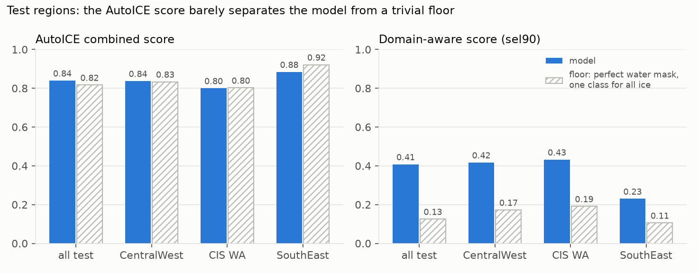
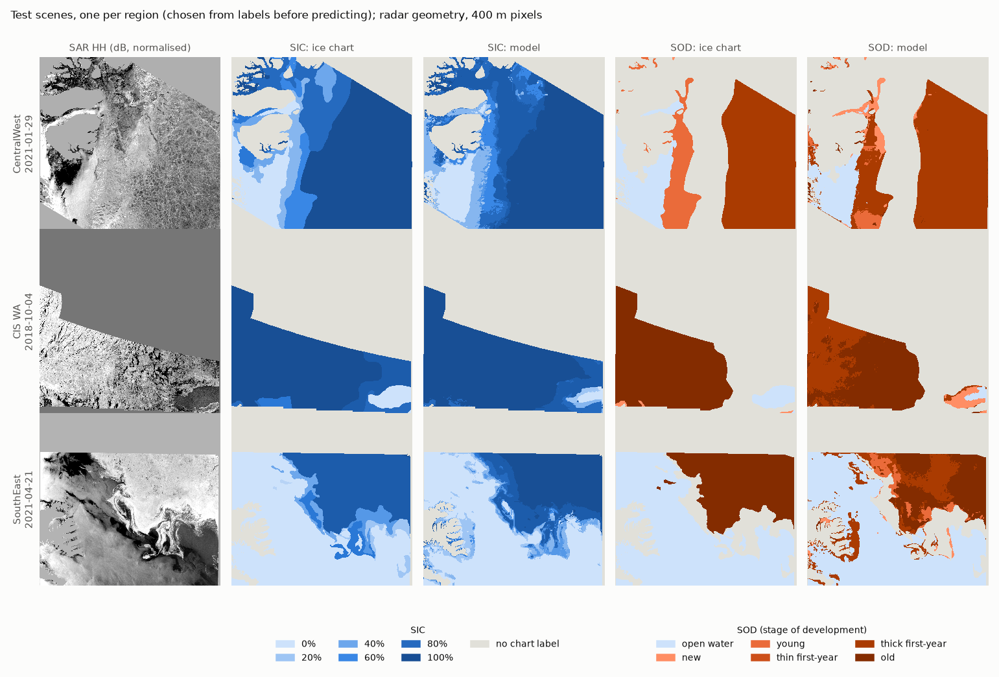
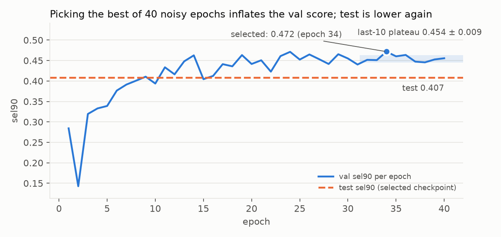
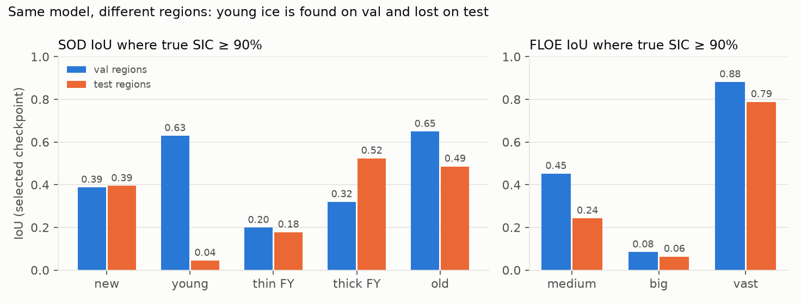
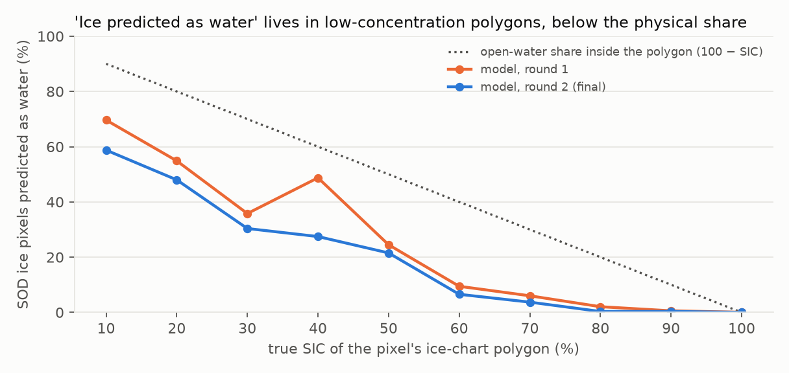
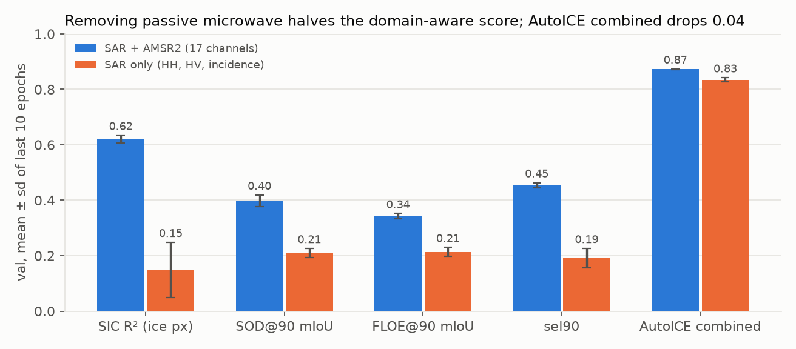
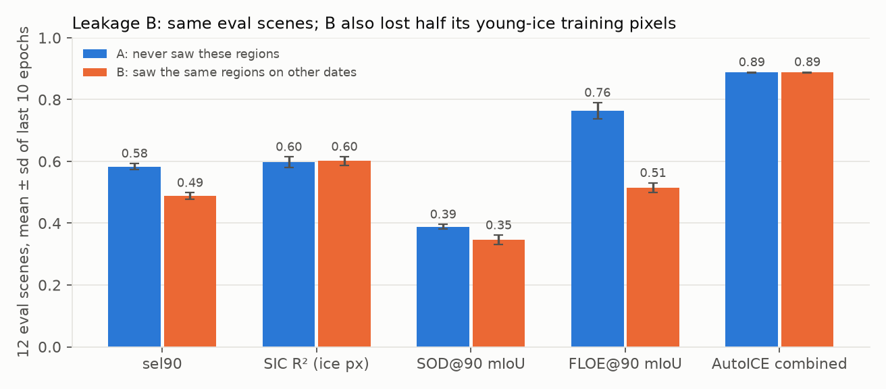

# Sea-ice segmentation from Sentinel-1 SAR and AMSR2

[](https://github.com/reddytian/sea-ice-segmentation/actions/workflows/tests.yml)

A multi-task U-Net that maps **sea-ice concentration (SIC), stage of development (SOD) and
floe size (FLOE)** from Sentinel-1 EW SAR and AMSR2 passive microwave, trained on the
AI4Arctic ready-to-train dataset. Built in PyTorch on a MacBook Air (Apple M5, MPS).

The model is ordinary. The point of this repository is the **evaluation**: a region-held-out
split chosen from the data, a floor baseline next to every score, metrics that respect how
ice charts are made, and experiments whose predictions were written down before they ran
-- including two that turned out wrong.



## Key findings

1. **The standard AutoICE score barely separates the model from a trivial baseline.**
   A model with a *perfect* water/ice mask that predicts one class for all ice scores
   0.817 on the test regions; the trained model scores 0.839, and falls *below* that floor
   in two of the three test regions. Open water is 54-67% of labelled pixels in the validation regions, and both
   R² and support-weighted F1 are dominated by it. On a domain-aware score (below) the
   same model reaches **0.41 against a floor of 0.13**.
2. **Most "ice predicted as water" errors are label resolution, not model failure.**
   Ice charts give one label per polygon. In a 20% concentration polygon ~80% of the
   pixels are open water labelled with an ice type. 95-97% of these errors fall in
   polygons at ≤ 50% concentration and none at 100% -- and the model calls *fewer*
   pixels water than the physical share.
3. **Passive microwave carries the concentration signal.** Removing the 14 AMSR2
   channels drops the ice-only SIC R² from 0.62 to 0.15 and the domain-aware score from
   0.45 to 0.19. The AutoICE score drops only 0.04.
4. **Generalisation fails by region, not uniformly.** Young ice is found on the
   validation regions (IoU 0.63) and almost lost on the test regions (0.04); thin
   first-year ice is recognised in Foxe Basin (83-92% recall) and not in north-east
   Greenland (19.6% in both training runs); south-east Greenland scores half of the other
   test regions.
5. **No evidence that seeing a region on other dates inflates scores here -- and two
   leakage experiments that each taught a design lesson.** A random scene split did
   not inflate validation as predicted, but its design could not separate leakage from
   val-set difficulty. A second experiment fixed that and found the model that had seen
   the evaluation regions scoring *lower*; the training-set swap had halved its young-ice
   pixels. On SIC, the one task whose training composition the swap left balanced,
   familiarity with the region was worth nothing measurable (R² 0.597 vs 0.602) --
   see [Leakage experiments](#leakage-experiments).

## Data

- **AI4Arctic Sea Ice Challenge, ready-to-train version** (Technical University of
  Denmark, [doi:10.11583/DTU.c.6244065](https://doi.org/10.11583/DTU.c.6244065)).
  A 123-scene subset of the training set: 16 regions (10 charted by DMI, 6 by CIS),
  2018-2021. Inputs are Sentinel-1 EW HH/HV at 80 m with incidence angle, and AMSR2
  brightness temperatures (6.9-89 GHz, H/V) on a 2 km grid; labels are rasterised ice
  charts. The data are not redistributed here. Figures contain modified Copernicus
  Sentinel data (2018-2021).
- Full-corpus label statistics (`scripts/corpus_stats.py`) before any design decision:
  - ~35% of SIC-labelled ice pixels have no SOD/FLOE label, so each task needs its own mask.
  - SOD classes look rare in a 3-scene sample (0.02%) but are 1.8-2.4% of the corpus.
    They are *concentrated*: 90% of young ice (SOD 2) and of thin first-year ice (SOD 3)
    sits in about 10 scenes each, and one region (Qaanaaq) holds 47% of all thin
    first-year ice. Concentration, not rarity, is what constrains the split.

## Split: region-held-out, chosen by search

Scenes from one region share an ice regime, an ice service's charting conventions, and
often ice that is days apart, so the split holds out whole regions. Hand-picking regions
put 47% of thin first-year ice in test, so `scripts/make_split.py` searches all 160,160
partitions of 16 regions into 3 test / 3 val / 10 train under hard constraints:

- each held-out split has 19-24 scenes and both a DMI and a CIS region;
- every class of SIC, SOD and FLOE appears in ≥ 2 scenes of val and of test;
- train keeps ≥ 50% of every class.

214 partitions are feasible; the chosen one has the smallest worst-case class
over/under-representation (2.57×). The search reads label statistics only, never model
scores. Icebergs (FLOE 6) are report-only: DMI-only, 0.17% of FLOE pixels, and no
partition is feasible with them as a hard constraint.

| split | regions | scenes |
|---|---|---|
| test | CentralWest, SGRDIWA (CIS), SouthEast | 24 |
| val | NorthEast, SGRDIFOXE (CIS), SouthWest | 24 |
| train | the other 10 | 75 |

## Preprocessing (`scripts/build_cache.py`)

- **400 m grid**: SAR block-averaged ×5. **Labels take the block centre pixel**, not the
  block majority, which would erode small classes along every boundary.
- **AMSR2 resampled at a fixed 25-pixel spacing**, not stretched over the scene: in 118
  of 123 scenes the 2 km grid has exactly floor(N_SAR / 25) cells (one fewer in the rest),
  leaving 0-25 SAR pixels at the far edge with no AMSR2 cell. Stretching would shift the
  grid by up to a whole 2 km cell. Cell centres are assumed at SAR pixel 25k + 12.
- **Normalisation from train regions only** (the dataset is already standard-scaled; a
  second affine step with train statistics keeps val/test out of the inputs).
- Written as memory-mappable float16 `.npy` (~5 GB) so a 16 GB machine streams it.

## Model and training

- U-Net from [dl-learning Day 8](https://github.com/reddytian/dl-learning): four
  pooling levels, base width 32, **one shared encoder-decoder and three 1×1 heads**
  (SIC 11 classes, SOD 6, FLOE 7); 7.8 M parameters, 17 input channels. Trained from
  scratch: dl-learning Day 12 found no benefit from ImageNet initialisation on
  multispectral input, and 5-6× higher seed-to-seed variance.
- Masked multi-task cross-entropy, a separate `ignore_index` mask per task, and a guard
  that returns an exact zero when a batch has no labels for a task (PyTorch's mean
  reduction returns NaN there).
- Class weights ∝ 1/√frequency from the train split. AdamW (lr 1e-3, weight decay 1e-2),
  300-step warm-up then cosine; 150 steps of 16 × 256² crops per epoch; flips and 90°
  rotations; 40 epochs, ~2 h on the M5 Air.
- Crops are drawn from scenes in proportion to their labelled pixels (median crop is
  99% labelled); evaluation tiles cover every pixel of a split exactly once.

## Evaluation

Every report shows the model next to a **floor**: a model with a perfect water/ice mask
that predicts one constant class (the best one) for all ice. It is computed from the true
label counts alone.

| score | definition | why |
|---|---|---|
| AutoICE combined | (2·R²_SIC + 2·F1_SOD + F1_FLOE) / 5, the [challenge weights](https://platform-challenges.philab.esa.int/auto-ice/data) | comparability with the literature; F1 is support-weighted here (the challenge page does not state the averaging) |
| **sel90** (checkpoint selection) | mean of three terms below | |
| · SIC R² on ice pixels | R² over pixels whose true SIC > 0 | ordinal (90% vs 80% is a near miss), not dominated by open water |
| · SOD@90, FLOE@90 | mIoU over ice classes, only where true SIC ≥ 90% | where a polygon label describes the pixel; 77% of SOD ice pixels in val |

The test split is scored once per experimental arm; `evaluate.py` refuses a second test
run without `--force`.

## Results

**Final model on the test regions** (checkpoint selected on val by sel90):

| | sel90 | SIC R² (ice) | SOD@90 | FLOE@90 | mIoU (all) | AutoICE combined |
|---|---|---|---|---|---|---|
| model | **0.407** | 0.533 | 0.325 | 0.365 | 0.309 | 0.839 |
| floor | 0.126 | | | | 0.205 | 0.817 |

| test region | sel90 | floor | AutoICE combined | floor |
|---|---|---|---|---|
| CentralWest (DMI) | 0.417 | 0.172 | 0.837 | 0.833 |
| SGRDIWA (CIS) | 0.432 | 0.191 | 0.800 | 0.802 |
| SouthEast (DMI) | 0.230 | 0.106 | 0.884 | 0.921 |



One test scene per region, chosen from the labels before predicting (the scene with the
most SOD-labelled pixels at ≥ 90% concentration); model output is masked to the chart's
labelled area so each pair covers the same pixels.

- The model's concentration follows SAR texture (leads, floe edges) at pixel scale; the
  chart is a set of polygons. Much of the per-pixel "error" is that difference.
- CentralWest: the chart's band of young ice is predicted as thick first-year ice --
  the young-ice IoU of 0.04 on test, seen on a map.
- SGRDIWA: ice charted as old is partly predicted as thick first-year, the same
  first-year/old confusion seen on validation.

**Val → test, and why a best-epoch score overstates.** The checkpoint score is the
maximum of 40 noisy epochs (0.472) against a last-10-epoch plateau of 0.454 ± 0.009; the
test score is 0.407. Configurations are therefore compared on plateau means, never on
best epochs (`scripts/compare_runs.py`).



**Where the errors are.** SOD/FLOE ice-class IoU at ≥ 90% concentration, val vs test:



- Young ice: 0.63 on val, 0.04 on test. Thin first-year ice in north-east Greenland is
  mostly called old ice (48-56%) in both runs, with recall fixed at 19.6%.
- Small floes (20-100 m) score ≤ 0.03 on val even at ≥ 90% concentration: they are
  smaller than a 400 m pixel.
- The largest water/ice errors are in June-September scenes (wet snow, melt ponds).

**Label resolution.** SOD ice pixels predicted as water, by the true concentration of
their ice-chart polygon:



## Experiments

All compared on the validation plateau (mean ± sd of the last 10 epochs).

| run | change | sel90 | mIoU (all) | AutoICE combined |
|---|---|---|---|---|
| round 1 | baseline, weight decay 1e-4, flips | - | 0.339 ± 0.004 | 0.871 ± 0.003 |
| **round 2** (final) | + 90° rotations, weight decay 1e-2, select on sel90 | 0.454 ± 0.009 | 0.342 ± 0.005 | 0.872 ± 0.002 |
| SAR only | drop the 14 AMSR2 channels | 0.191 ± 0.035 | 0.278 ± 0.007 | 0.834 ± 0.008 |

- **Regularisation:** no measurable gain (mIoU over epochs 27-30: 0.339 vs 0.338). It
  delayed the best epoch from 20 to 34 without raising the plateau.
- **AMSR2 ablation:**



  The SAR-only model was trained at 400 m; at native 80 m resolution SAR texture may
  carry more than this shows.

### Leakage experiments

**A. Region split vs random scene split.** dl-learning Day 11 measured, on synthetic
data, that a random split inflated validation mIoU by 16.5 points. The same comparison
here: both arms share the 24 test scenes; the random arm shuffles the other 99 scenes
into train/val (all 24 of its val scenes share a region with its train set).

*Prediction, written before the run:* the random arm's validation score is inflated, so
its val − test gap is larger.

| arm | val (selected) | test | val − test |
|---|---|---|---|
| region split | 0.472 | 0.407 | 0.064 |
| random split | 0.414 | 0.384 | 0.031 |

*Result:* the opposite. The two arms are validated on **different scenes**, so val − test
mixes leakage with how much easier each val set is than test, and the design cannot
separate them. What the data do show: the region arm's gap comes from one hard test
region -- without SouthEast, the other two test regions (0.42, 0.43) match the val
regions. **Between-region variance is larger than the effect the experiment tried to
measure**, which is why every result here is reported per region.

**B. Same evaluation scenes, two training sets.** Twelve scenes from the val regions
(every second one by date) are scored by two models trained for 30 fixed epochs with
no checkpoint selection:

- **A** trains on the 75 region-split train scenes and has never seen those regions;
- **B** swaps 12 random train scenes for the other 12 scenes of the same regions
  (other dates, 12-324 days away, median 34).

*Prediction and decision rule, fixed in advance:* B ≥ A. With one seed per model, a
sel90 difference below 0.03, or inconsistent in direction across the three regions,
counts as indistinguishable.



| (plateau, last 10 epochs) | A: never saw regions | B: saw other dates | B − A |
|---|---|---|---|
| sel90 | 0.583 ± 0.010 | 0.488 ± 0.011 | **−0.096** |
| SIC R² (ice px) | 0.597 ± 0.018 | 0.602 ± 0.014 | +0.005 |
| SOD@90 mIoU | 0.388 ± 0.008 | 0.346 ± 0.015 | −0.042 |
| FLOE@90 mIoU | 0.764 ± 0.026 | 0.515 ± 0.016 | −0.249 |
| AutoICE combined | 0.887 ± 0.002 | 0.888 ± 0.001 | +0.001 |

Final epoch, per region (sel90): north-east Greenland 0.510 → 0.428, Foxe Basin
0.544 → 0.337, south-west Greenland 0.648 → 0.550. The difference passes the decision
rule -- large and consistent across regions -- **in the opposite direction from the
prediction**.

*Why.* The swap changed more than region familiarity. The 12 scenes removed from B
held much of the young ice: B trained on **52% of A's young-ice pixels** (and 81% of
its medium-floe pixels), and young ice is 9% of the evaluation scenes' ice. Young-ice
IoU at ≥ 90% concentration fell from 0.68 to 0.34. Two of the four Foxe Basin scenes
B gained are 93% and 98% unlabelled, so the region that dropped most gained least.
This asymmetry was named before the run ("if the dropped scenes happen to be unusually
informative, A is favoured") but not *checked* -- the corpus statistics that drove the
split search could have matched the swap by class composition in seconds.

*What it does show.* SIC is the task whose training composition the swap left balanced
(ice pixels 1.04×, every concentration class within ±30%). There, having seen the same
regions on other dates was worth +0.005 R², inside one standard deviation. Same-region
scenes are typically a month or more apart (median 34 days to the nearest), long
enough for the ice itself to change -- a plausible reason the Day 11 effect, which came
from tiles 128 px apart in one scene, does not appear at the scene level here. That
reason is a hypothesis, not tested.

## Limitations

- One random seed per configuration; three test regions. Differences below ~0.03 sel90
  are not distinguishable here.
- Leakage experiment B is confounded by class composition (above). A composition-matched
  swap was not run.
- 400 m pixels: cake ice and small floes are unresolvable; SAR texture is partly averaged away.
- Ice-chart labels are polygon-level and analyst-dependent, and conventions differ between
  services: in this subset the CIS-charted regions contain no icebergs and little thin
  first-year ice.
- FLOE 6 (icebergs) is report-only: 68% of its pixels are outside train.
- The AMSR2 grid origin (cell centre at SAR pixel 25k + 12) is assumed; the spacing is
  verified. An error in the origin is at most half a 2 km cell.

## Tests

`pytest -q` runs 21 tests on synthetic data in a few seconds, on CPU, and in CI on every
push. They pin down the properties the results depend on: evaluation tiles cover every
pixel exactly once; flips and rotations keep inputs and labels aligned; AMSR2 is resampled
at a fixed 25-pixel spacing rather than stretched; masked cross-entropy is exact zero (not
NaN) on an unlabelled batch; the metrics match direct computation; the leakage-B splits
differ only in the swapped scenes. Breaking the rotation or the AMSR2 mapping on purpose
fails the corresponding test.

## Reproduce

```bash
pip install -r requirements.txt && pytest -q
python scripts/corpus_stats.py                      # label statistics, cached
python scripts/make_split.py                        # -> configs/split_region_v1.json
python scripts/build_cache.py --dry-run && python scripts/build_cache.py
python scripts/check_data.py                        # throughput, class weights, tile counts
python scripts/train.py --run-dir runs/unet_r2 --rot90 --wd 1e-2
python scripts/evaluate.py --run-dir runs/unet_r2 --split val
python scripts/diagnose_val.py --run-dir runs/unet_r2
python scripts/train.py --run-dir runs/unet_r3_sar --rot90 --wd 1e-2 --channels sar
python scripts/make_random_split.py && \
  python scripts/train.py --run-dir runs/unet_rand --rot90 --wd 1e-2 --split-file configs/split_random_v1.json
python scripts/make_leak_split.py && for s in A B; do \
  python scripts/train.py --run-dir runs/leak_$s --rot90 --wd 1e-2 --epochs 30 --patience 1000 \
    --split-file configs/split_leak$s.json; done
python scripts/evaluate.py --run-dir runs/unet_r2 --split test     # once per arm
python scripts/evaluate.py --run-dir runs/unet_rand --split test
python scripts/compare_runs.py runs/unet_r2 runs/unet_r3_sar runs/unet_rand
python scripts/make_figures.py
python scripts/predict_maps.py --run-dir runs/unet_r2
```

```
src/seaice/   data.py (crops, tiles, class weights)  model.py  losses.py  metrics.py  engine.py
scripts/      corpus_stats  make_split  build_cache  check_data  train  evaluate
              diagnose_val  compare_runs  make_random_split  make_leak_split  make_figures
              predict_maps
configs/      split files (region, random, leakage B)
tests/        pytest suite on synthetic data (no download needed)
docs/figures/ generated by make_figures.py and predict_maps.py
```

## References

- Chen, X. et al. (2024). MMSeaIce: a collection of techniques for improving sea ice
  mapping with a multi-task model. *The Cryosphere*, 18, 1621-1632.
  [doi:10.5194/tc-18-1621-2024](https://doi.org/10.5194/tc-18-1621-2024)
- AI4Arctic Sea Ice Challenge Dataset, Technical University of Denmark.
  [doi:10.11583/DTU.c.6244065](https://doi.org/10.11583/DTU.c.6244065)
